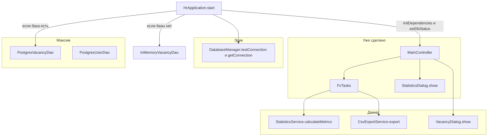
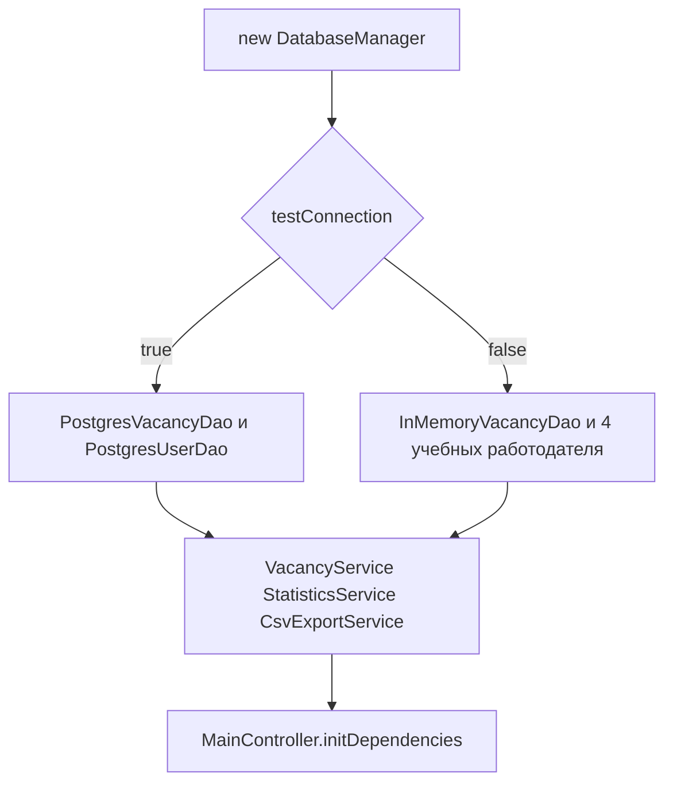
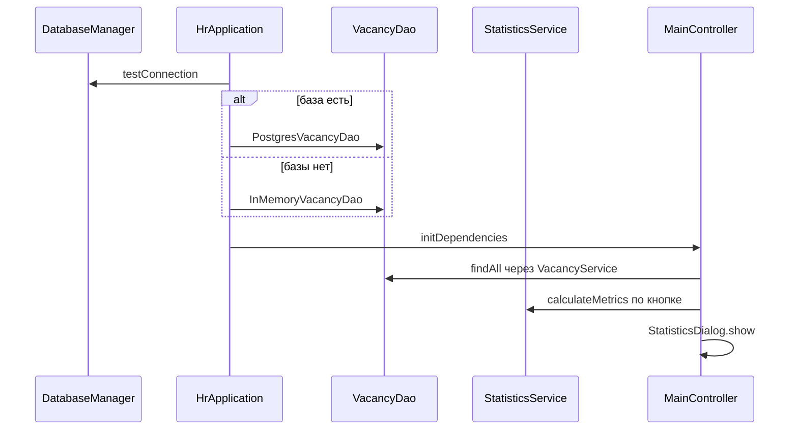

# Куда подключать интерфейс Глеба

Окно уже умеет звать чужие методы. Этот текст говорит, какой метод кто реализует и что увидит пользователь, когда метод заработает. Общее устройство экрана — в [gleb-ui.md](gleb-ui.md).

Менять `MainController`, `FxTasks` и `StatisticsDialog` для подключения не нужно. Нужно выполнить контракты, которые контроллер уже вызывает.

## Кто за что отвечает



`HrApplication` уже выбирает источник данных:



Сейчас `testConnection()` возвращает `false` всегда. Поэтому ветка PostgreSQL не выполняется, даже если Docker запущен. Это временная заглушка, чтобы окно собиралось. Её нужно заменить, а не оставить.

## Эдик: база

Файл: `javafx-client/src/main/java/ru/mirea/hrsystem/util/DatabaseManager.java`.

| Метод | Что ждёт приложение | Что сейчас |
|---|---|---|
| `boolean testConnection()` | `true`, если база открылась; `false`, если нет. Исключение наружу не бросать: `HrApplication` по `false` включает стаб | всегда `false` |
| `Connection getConnection()` | живое JDBC-соединение из `database.properties` | бросает `UnsupportedOperationException` |

`getConnection()` вызывает `PostgresUserDao`. Пока `testConnection()` ложен, этот метод не нужен для экрана. Как только проверка начнёт возвращать `true`, оба Postgres-DAO обязаны работать, иначе окно упадёт на первой загрузке.

Пароль остаётся в `database.properties`, не в Java-коде.

## Максим: вакансии из PostgreSQL

Файл: `repository/PostgresVacancyDao.java`.

Конструктор `PostgresVacancyDao(DatabaseManager)` уже есть: его вызывает `HrApplication`. Методы интерфейса `VacancyDao` пока все бросают «Метод не реализован».

Контроллер сам эти методы не вызывает. Он зовёт `VacancyService`, а сервис уже ходит в DAO:

| Действие на экране | Метод сервиса | Метод DAO |
|---|---|---|
| Открытие и «Обновить» | `getAllVacancies()` | `findAll()` |
| Удалить | `deleteVacancy(id)` | `delete(id)` |
| После диалога Дамира | `create` / `update` внутри диалога или сервиса | `create` / `update` |

`PostgresUserDao.findAllEmployers()` уже написан и нужен выпадающему списку компаний. Он заработает вместе с настоящим `getConnection()`.

Для экрана важны поля, которые таблица читает у `Vacancy`: `id`, `title`, `description`, `salaryMin`, `salaryMax`, `status`, `employerId`, `employerCompanyName`. Если компания пустая, колонка покажет `ID #<employerId>`.

## Дамир: три метода, которые кнопки уже ждут

### Статистика

```java
StatisticsDto StatisticsService.calculateMetrics()
```

Контроллер вызывает это в `FxTasks.run`. Успех открывает `StatisticsDialog.show(window, dto)`. Исключение показывает «Ошибка статистики» и окно с нулями не открывает.

`StatisticsDto` — record с пятью полями: `totalVacancies`, `activeVacancies`, `archivedVacancies`, `averageSalaryMin`, `maxSalary`. Зарплаты можно передать как `BigDecimal`. Пустую сумму лучше отдать как `BigDecimal.ZERO`, не как `null`. Окно само нарисует `0 ₽`.

В сервис нельзя импортировать `javafx.*`. Окно уже нарисовано.

### Экспорт

```java
void CsvExportService.export(List<Vacancy> vacancies, File targetFile) throws Exception
```

Контроллер сам открывает `FileChooser`, сам копирует видимые строки и сам гасит кнопку. В сервис приходит обычный `List` и уже выбранный `File`. `FileChooser`, `Alert` и `Stage` в сервис класть не нужно: ошибку достаточно бросить, контроллер покажет «Ошибка экспорта» и снова включит кнопку.

В файл попадают только строки, которые были видны в момент нажатия. Если на экране 2 вакансии, в снимке 2 объекта плюс заголовок, который пишет сервис.

### Диалог вакансии

```java
public static void show(Window owner, Vacancy vacancy, List<User> employers)
```

Сигнатура уже подогнана под контроллер. `List<Object>` больше не подходит: список работодателей имеет тип `List<User>`.

| Вызов | Значение `vacancy` |
|---|---|
| «Новая вакансия» | `null` |
| «Редактировать» и двойной щелчок | выбранная строка |

`employers` — компании для `ComboBox`. У `User` уже есть `toString()` вида `Яндекс (yandex_hr@yandex.ru)`.

Когда человек сохранил форму, метод должен просто вернуться. Контроллер после `show` вызывает `loadData()` и перечитывает таблицу. Когда человек отменил, метод тоже возвращается без исключения: таблица обновится тем же списком.

Если форма невалидна, окно диалога остаётся открытым. Исключение наружу имеет смысл бросать только при настоящей ошибке. Сейчас метод бросает `UnsupportedOperationException`, и контроллер показывает «Диалог вакансии».

Разметку формы класть в `view/VacancyDialog.fxml`, логику полей — в `VacancyDialogController`. `MainView.fxml` для этого трогать не нужно.

## Что нельзя переименовывать

`MainView.fxml` связан с полями и методами контроллера. Если убрать `fx:id` или `onAction`, окно не загрузится.

| `fx:id` или `onAction` | Поле или метод |
|---|---|
| `dbStatusLabel` | шапка |
| `countLabel` | «Показано: X из Y» |
| `searchField` | поиск |
| `statusFilterComboBox` | статус |
| `salaryRangeFilterComboBox` | зарплата |
| `vacancyTableView` и шесть колонок `idColumn` … `statusColumn` | таблица |
| `refreshButton` | `#handleRefresh` |
| `addButton` | `#handleAddVacancy` |
| `editButton` | `#handleEditVacancy` |
| `deleteButton` | `#handleDeleteVacancy` |
| кнопка статистики | `#handleShowStatistics` |
| `exportButton` | `#handleExportCsv` |
| кнопка сброса | `#handleResetFilters` |

Кнопка статистики без `fx:id`: контроллер не гасит её через binding, а выходит сразу, если `busy` уже включён.

Пункты зарплаты должны совпасть с текстом в `MainController` символ в символ, включая тире в `100 000–200 000`. Другое тире сломает `switch`, и диапазон перестанет фильтровать.

Классы CSS, которые Java добавляет сам: `metric-card`, `metric-value`, `metric-title`, `secondary-button`. Псевдокласс строки: `archived`.

## Порядок, в котором всё сходится



Один и тот же `VacancyDao` уже передаётся и в `VacancyService`, и в `StatisticsService`. Таблица и карточки тогда смотрят в одни данные. Второй источник заводить не нужно.

## Как понять, что стык живой

1. Без Docker таблица показывает 8 строк, шапка — автономный режим.
2. «до 100 000» оставляет стажёра и Junior QA.
3. «Spring» оставляет Java Backend и Middle Spring Boot.
4. Удаление на стабе убирает строку после подтверждения.
5. `calculateMetrics()` возвращает DTO — открываются 5 карточек, не окно ошибки.
6. `export` дописывает файл — кнопка гаснет на время записи и загорается снова, в файле столько строк, сколько было видно.
7. `VacancyDialog.show` возвращается без исключения — таблица перечитывается.
8. `testConnection()` при живом Docker возвращает `true`, шапка меняется на «PostgreSQL подключен», список приходит из `PostgresVacancyDao.findAll()`.
