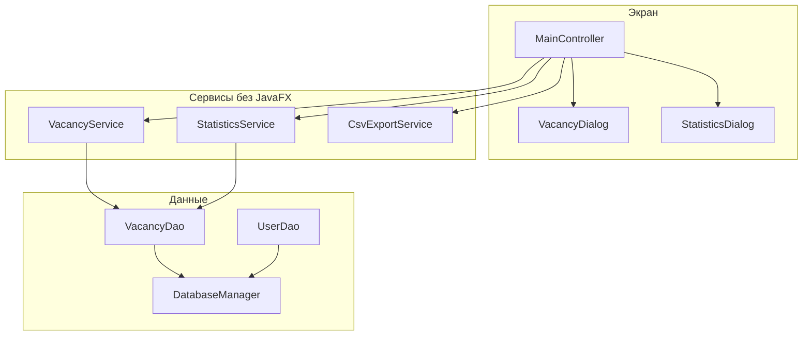
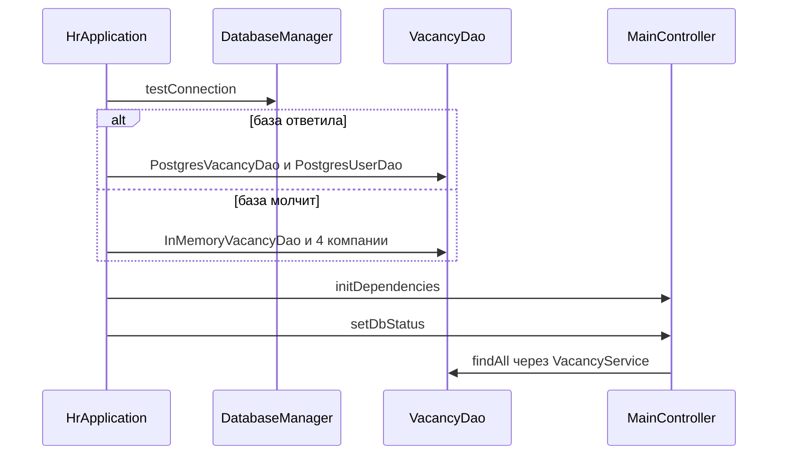

# Куда что подключено

Окно не создаёт базу и не считает метрики само. Оно вызывает уже собранные объекты. Этот текст показывает, какой метод кто вызывает и что произошло с чужим кодом.

Как выглядит экран — в [gleb-ui.md](gleb-ui.md). Разбор языка — в [gleb-java-tutorial.md](gleb-java-tutorial.md).

## Ветки

На сервере до этой работы были только две ветки.

| Ветка | Что в ней |
|---|---|
| `Gleb_dev_main_branch` | интерфейс: фильтры, `FxTasks`, окно статистики, снимок для экспорта |
| `main` | один коммит Дамира: `StatisticsService.calculateMetrics()` |
| `test/full-integration` | обе ветки плюс база, SQL вакансий, CSV и форма |

Других веток и pull request не было. Форма, экспорт и JDBC в `main` оставались заглушками с `UnsupportedOperationException`. На тестовой ветке они заменены рабочим кодом, иначе кнопки показывали бы ошибку.



## Старт: кто что создаёт

`HrApplication.start` делает это до показа окна.



Сигнатура, которую экран уже ждёт:

```java
void initDependencies(VacancyService vacancyService,
                      UserDao userDao,
                      StatisticsService statisticsService,
                      CsvExportService csvExportService)
void setDbStatus(boolean connected)
```

Один и тот же `VacancyDao` передаётся и в `VacancyService`, и в `StatisticsService`. Таблица и карточки смотрят в одни данные.

## База

Файл `util/DatabaseManager.java`. Настройки только в `src/main/resources/database.properties`:

```properties
db.url=jdbc:postgresql://localhost:5432/hr_system_db
db.user=hr_user
db.password=hr_password
db.driver=org.postgresql.Driver
```

| Метод | Поведение |
|---|---|
| `testConnection()` | `true`, если `isValid` прошёл. `false`, если сервер не ответил. Исключение, если нет файла или ключа |
| `getConnection()` | новое JDBC-соединение. Пароль из файла, не из кода |

`PostgresUserDao.findAllEmployers()` уже умел читать компании и зовёт `getConnection()`.

`PostgresVacancyDao` закрывает контракт `VacancyDao`:

| Экран | Сервис | SQL |
|---|---|---|
| Открытие и «Обновить» | `getAllVacancies()` | `SELECT` с `LEFT JOIN users` |
| Сохранить новую | `createVacancy` | `INSERT` и сгенерированный `id` |
| Сохранить правку | `updateVacancy` | `UPDATE ... WHERE id = ?` |
| Удалить | `deleteVacancy` | `DELETE FROM vacancies WHERE id = ?` |

Колонка компании в таблице — `users.company_name`. Если её нет, экран пишет `ID #<employerId>`.

## Статистика

`StatisticsService.calculateMetrics()` пришёл с `main`. Он обходит `findAll()`, считает всего, активных, архивных, среднее `salaryMin` и максимум `salaryMax`. Окно только раскладывает `StatisticsDto` по пяти карточкам. В сервисе нет импортов `javafx`.

На восьми учебных вакансиях это 8, 6, 1, 175625 и 480000. Пустой список даёт нули: среднее берётся через `orElse(0)`, деления на ноль нет.

## Экспорт

Контроллер на потоке окна открывает `FileChooser`, копирует видимые строки и гасит кнопку. Сервис получает обычный `List` и `File`:

```java
void export(List<Vacancy> vacancies, File targetFile) throws Exception
```

Внутри нет `FileChooser` и `Alert`. Ошибку он бросает наверх, кнопка включается в `onFailure`.

Файл: UTF-8, три байта BOM `EF BB BF`, разделитель `;`. Поле с `;`, кавычкой или переводом строки оборачивается в кавычки, внутренняя кавычка удваивается. Так Excel не сдвигает соседние колонки.

## Форма вакансии

```java
static Vacancy show(Window owner, Vacancy vacancy, List<User> employers)
```

| Кнопка | Аргумент `vacancy` | Возврат |
|---|---|---|
| Новая | `null` | новая вакансия или `null` |
| Редактировать, двойной щелчок | выбранная строка | копия с тем же `id` или `null` |

`null` значит «Отмена»: таблица не перечитывается. Иначе контроллер вызывает `createVacancy` или `updateVacancy` и делает `loadData()`.

Поля формы: `titleField`, `employerComboBox`, `salaryMinField`, `salaryMaxField`, `statusComboBox`, `descriptionArea`, `errorLabel`, `saveButton`, `cancelButton`. На «Сохранить» висит `EventFilter`. При ошибке событие съедается, окно остаётся, поле получает класс `field-error`.

Имена в `MainView.fxml` нельзя переименовывать вразнобой с полями `MainController`. Текст диапазона `100 000–200 000` должен совпасть с `switch` символ в символ.

## Как убедиться, что стык живой

1. Без Docker: 8 строк, шапка про автономный режим.
2. «до 100 000» оставляет 45 000 и 80 000. «Spring» оставляет две вакансии.
3. «Статистика» открывает 5 карточек: 8, 6, 1, 175 625 ₽, 480 000 ₽.
4. «Новая вакансия» с пустым названием не закрывается. С нормальным названием строка появляется после сохранения.
5. «Экспорт» пишет файл с заголовком и столькими строками, сколько было видно. Точка с запятой в названии остаётся в одной ячейке.
6. Удаление после «Да» убирает строку.
7. С запущенным Docker шапка меняется на «PostgreSQL подключен», список идёт из `PostgresVacancyDao`.
8. `mvn test` в `javafx-client` — 13 тестов.
