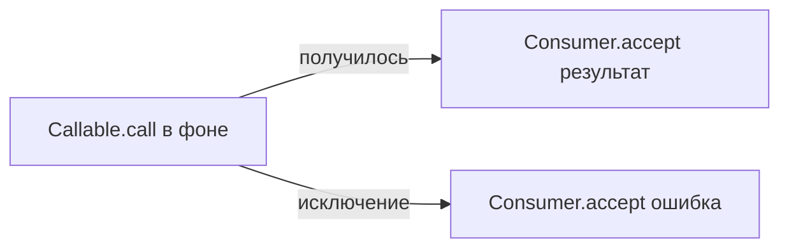
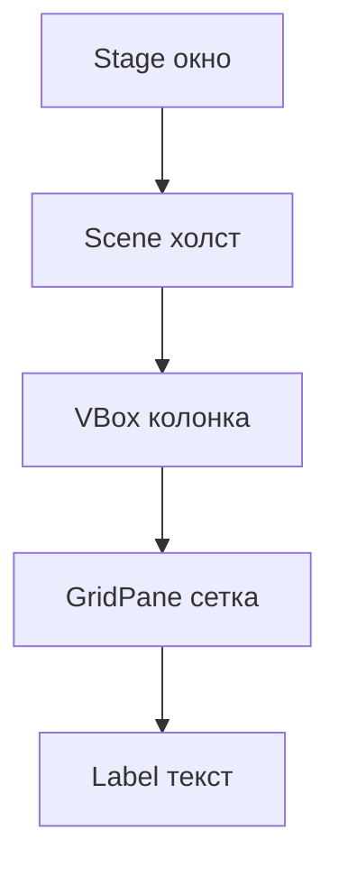
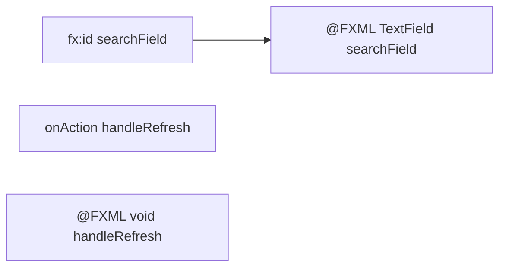
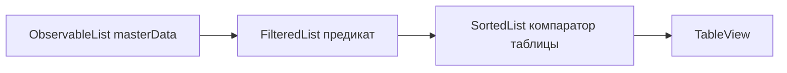
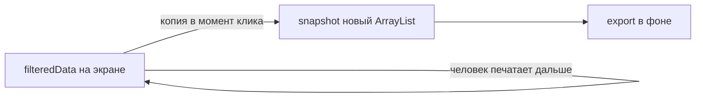
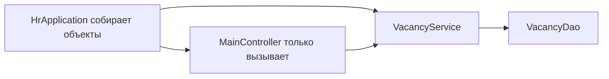

# Java на примере окна вакансий

Этот текст учит читать и писать такой код, какой лежит в интерфейсе Глеба. Сначала маленький пример, потом то же самое в проекте. Как само окно устроено для пользователя, написано в [gleb-ui.md](gleb-ui.md). Куда втыкать чужие методы — в [gleb-integration.md](gleb-integration.md).

Читать лучше по порядку. Каждый урок короткий, но следующий опирается на предыдущий.

Код проекта:

- `javafx-client/src/main/java/ru/mirea/hrsystem/ui/util/FxTasks.java`
- `javafx-client/src/main/java/ru/mirea/hrsystem/ui/MainController.java`
- `javafx-client/src/main/java/ru/mirea/hrsystem/ui/StatisticsDialog.java`
- `javafx-client/src/test/java/ru/mirea/hrsystem/ui/VacancyFilterTest.java`

## 1. Класс, пакет и метод

Класс — чертёж объектов. Метод — действие, которое умеет класс. Пакет — папка, чтобы классы с одинаковым именем не столкнулись.

```java
package ru.mirea.hrsystem.ui.util;

public final class FxTasks {
    public static <T> void run(...) { }
}
```

`package ru.mirea.hrsystem.ui.util` значит: файл лежит в `.../ru/mirea/hrsystem/ui/util/FxTasks.java`. Имя пакета и путь обязаны совпасть.

Общий пример. Класс «корзина» с одним действием:

```java
package shop;

public class Basket {
    public void add(String item) {
        System.out.println("Положили: " + item);
    }
}
```

Вызов: `new Basket().add("хлеб")`. Слово `new` создаёт объект. Пока объекта нет, обычный метод звать некому.

В проекте `MainController` как раз такой объект: его создаёт JavaFX, когда читает FXML. Мы сами `new MainController()` не пишем.

## 2. Зачем классу закрытый конструктор

`FxTasks` и `StatisticsDialog` помечены `final`, а конструктор у них `private` и пустой.

```java
public final class FxTasks {
    private FxTasks() {
    }
}
```

`final` у класса запрещает наследование: от `FxTasks` нельзя сделать подкласс. Это утилита, а не заготовка для наследников.

`private` конструктор запрещает `new FxTasks()`. Объект не нужен: все методы статические, состояние хранить негде. Если конструктор не написать вообще, Java сама добавит публичный, и `new` снова станет возможным. Пустой `private` конструктор как раз это и закрывает.

Общий пример. Набор формул, которому нечего помнить:

```java
public final class MoneyText {
    private MoneyText() {}

    public static String rubles(long amount) {
        return amount + " ₽";
    }
}
```

Правильно: `MoneyText.rubles(100)`. Неправильно: `new MoneyText()`.

Так же устроен `UiUtils`: три статических метода окон, конструктор закрыт.

## 3. Статический метод

Обычный метод принадлежит объекту (`vacancy.getTitle()`). Статический принадлежит классу (`FxTasks.run(...)`).

Статический метод не видит поля конкретного объекта, потому что объекта может не быть. Ему передают всё нужное аргументами.

В проекте статические куски контроллера — это чистые проверки. Им не нужна таблица:

```java
static boolean matches(Vacancy vacancy, String query, String status, String salaryRange)
```

Их можно вызвать из теста, не открывая окно. Методы вроде `loadData()` статические быть не могут: они читают поля `vacancyService` и `masterData` у конкретного контроллера.

Общий пример:

```java
public class Greeter {
    private String name;

    public Greeter(String name) {
        this.name = name;
    }

    public String hello() {
        return "Привет, " + name;
    }

    public static String hello(String name) {
        return "Привет, " + name;
    }
}
```

`new Greeter("Анна").hello()` и `Greeter.hello("Анна")` дают одну фразу. Первый вариант нужен, если имя живёт в объекте. Второй — если имя пришло на один вызов.

## 4. Обобщения: один метод на разные типы

В `FxTasks.run` есть `<T>`. Буква T — это «тип, который станет известен в месте вызова».

```java
public static <T> void run(Callable<T> work, Consumer<T> onSuccess, Consumer<Throwable> onFailure)
```

Когда загружаем вакансии, T становится `PageData`. Когда пишем файл, T становится `File`. Метод один.

Общий пример. Коробка, в которую кладут что угодно, но достают тем же типом:

```java
public class Box<T> {
    private T value;

    public void put(T value) {
        this.value = value;
    }

    public T get() {
        return value;
    }
}
```

`Box<String> names = new Box<>();` не примет число. `Box<Integer>` не примет строку. Компилятор ловит путаницу до запуска.

`List<Vacancy>` в контроллере — тот же приём: список обещает, что внутри вакансии, не кнопки и не строки.

## 5. Интерфейсы Callable и Consumer

Интерфейс говорит: «у меня есть такой метод», но не говорит, что внутри.

`Callable<T>` — работа, которая возвращает T и имеет право бросить исключение. У него один метод: `T call()`.

`Consumer<T>` — действие над готовым T, ничего не возвращает. Метод: `void accept(T value)`.

`FxTasks` сам не знает, что грузить. Ему отдают две роли:



Общий пример без JavaFX. «Принеси число, если сможешь»:

```java
Callable<Integer> parse = () -> Integer.parseInt("42");
Consumer<Integer> print = number -> System.out.println(number);
```

`parse.call()` вернёт 42. `print.accept(42)` напечатает его. В проекте вместо печати стоит `masterData.setAll(...)`.

`Consumer<Throwable>` — тот же потребитель, только ему отдают ошибку. Поэтому и успех, и провал обрабатываются одинаковым способом: «возьми значение и сделай что-то».

## 6. Лямбда и ссылка на метод

Лямбда — короткая запись метода на один раз.

```java
FxTasks.run(
    () -> new PageData(vacancyService.getAllVacancies(), userDao.findAllEmployers()),
    page -> {
        masterData.setAll(page.vacancies());
        setBusy(false);
    },
    error -> showError("Ошибка загрузки", error));
```

Слева от стрелки аргументы, справа тело.

| Запись | Что это |
|---|---|
| `() -> ...` | аргументов нет, так устроен `call()` |
| `page -> ...` | один аргумент, имя мы выбрали сами |
| `vacancy -> matches(...)` | то же для предиката фильтра |
| `event -> stage.close()` | аргумент есть, но нам важен только факт клика |

Если лямбда только вызывает уже существующий метод с теми же аргументами, пишут ссылку:

```java
FxTasks.run(statisticsService::calculateMetrics, dto -> { ... }, error -> { ... });
FxTasks.run(userDao::findAllEmployers, list -> { ... }, error -> { ... });
```

`statisticsService::calculateMetrics` значит: у этого объекта вызови `calculateMetrics`, когда придёт время `call()`. Это то же самое, что `() -> statisticsService.calculateMetrics()`.

Общий пример. Оба варианта печатают длину слова:

```java
Function<String, Integer> byLambda = word -> word.length();
Function<String, Integer> byReference = String::length;
```

Ссылку удобно писать, когда метод уже назван. Лямбду — когда внутри два-три шага, как в успешной загрузке: запомнить работодателей, заменить строки, обновить счётчик, снять «занято».

## 7. Анонимный класс и override

`Task` — готовый класс JavaFX. Его метод `call()` пустой по смыслу: библиотека не знает нашу работу. Мы создаём подкласс прямо в месте вызова.

```java
Task<T> task = new Task<>() {
    @Override
    protected T call() throws Exception {
        return work.call();
    }
};
```

`new Task<>() { ... }` — анонимный класс: наследник без своего имени. `@Override` говорит компилятору: «я заменяю метод родителя, проверь, что имя и аргументы совпали». Если опечататься в `call`, сборка упадёт, а не молча создаст второй метод.

Общий пример. У всех животных есть голос, кот переопределяет его:

```java
abstract class Animal {
    abstract String voice();
}

Animal cat = new Animal() {
    @Override
    String voice() {
        return "мяу";
    }
};
```

Так же сделана строка таблицы: `new TableRow<>() { @Override protected void updateItem(...) }`. Родитель умеет рисовать строку, мы добавляем полупрозрачность для архива.

## 8. Поток окна и фоновый поток

У JavaFX один поток имеет право менять кнопки и таблицу. Его называют потоком приложения. Если читать базу в этом же потоке, окно перестаёт двигаться: поток занят ожиданием.

```mermaid
flowchart TB
    click[Клик на потоке окна]
    start[new Thread task]
    call[call в фоне]
    back[setOnSucceeded снова на потоке окна]
    click --> start --> call --> back
```

В `FxTasks` это записано так:

```java
task.setOnSucceeded(event -> onSuccess.accept(task.getValue()));
task.setOnFailed(event -> onFailure.accept(task.getException()));
Thread thread = new Thread(task, "fx-background");
thread.setDaemon(true);
thread.start();
```

`setOnSucceeded` и `setOnFailed` сами переносят колбэк на поток окна. Поэтому `masterData.setAll` стоит в `onSuccess`, а `getAllVacancies` — внутри `call`.

`setDaemon(true)` значит: этот поток не держит программу, когда окно закрыли. Обычный поток не дал бы процессу завершиться.

Имя `"fx-background"` видно в логе. По нему понятно, кто записал строку «Загрузка всех вакансий».

Общий пример той же идеи без интерфейса. Долгий подсчёт и печать результата в нужном месте:

```java
Thread worker = new Thread(() -> {
    int sum = 0;
    for (int i = 0; i < 1_000_000; i++) {
        sum += i;
    }
    int result = sum;
    // напечатать result должен тот поток, которому принадлежит экран
});
worker.setDaemon(true);
worker.start();
```

В консоли печатать можно откуда угодно. В JavaFX обновлять `Label` можно только с потока окна. `Task` как раз переносит результат сам. Свой `ExecutorService` в проекте не заводили: одной нитки на запрос достаточно.

Что будет, если перепутать стороны:

| Куда положили код | Что случится |
|---|---|
| `setText` внутри `call()` | `IllegalStateException`: не тот поток |
| `findAll()` прямо в обработчике кнопки | окно белеет на время запроса |
| `setAll` в `onSuccess` | таблица обновляется спокойно |

## 9. Record: объект из нескольких ответов

Загрузка приносит два списка сразу. Для этого внизу контроллера лежит запись:

```java
private record PageData(List<Vacancy> vacancies, List<User> employers) {}
```

Record сам пишет конструктор, геттеры и `equals`. Поля читаются как методы без `get`: `page.vacancies()`, `page.employers()`.

Зачем не два отдельных фоновых вызова. Один поход в фон, один момент, когда таблица обновляется. Меньше шансов, что вакансии уже новые, а компании ещё старые.

`StatisticsDto` — такой же record, только публичный, потому что его создаёт сервис, а читает окно:

```java
public record StatisticsDto(
        long totalVacancies,
        long activeVacancies,
        long archivedVacancies,
        BigDecimal averageSalaryMin,
        BigDecimal maxSalary) {}
```

`long` — целое число. Для счётчиков вакансий его хватает. Для денег рядом стоит `BigDecimal`, не `double`.

Общий пример. Точка на плоскости:

```java
public record Point(int x, int y) {}

Point a = new Point(2, 5);
int width = a.x();
```

Класс с двумя полями, конструктором и геттерами занял бы страницу. Record занимает строку. Его берут, когда объект только переносит данные и не умеет сложного поведения.

## 10. BigDecimal вместо double

`double` хранит дроби приблизительно. `0.1 + 0.2` в double не равно `0.3`. Для зарплаты это плохая идея.

```java
private static final BigDecimal SALARY_LOW = new BigDecimal("100000");
private static final BigDecimal SALARY_HIGH = new BigDecimal("200000");
```

Строка `"100000"` обязательна. `new BigDecimal(0.1)` снова принесёт погрешность double. `new BigDecimal("0.1")` хранит ровно одну десятую.

Сравнивать надо методом:

```java
salary.compareTo(SALARY_LOW) <= 0   // salary <= 100000
salary.compareTo(SALARY_HIGH) >= 0  // salary >= 200000
```

`compareTo` возвращает отрицательное число, ноль или положительное: меньше, равно, больше. Писать `salary == SALARY_LOW` нельзя: `==` сравнивает, тот ли это объект в памяти, а не равны ли суммы.

Общий пример. Две коробки по 10 рублей — разные объекты, одна сумма:

```java
BigDecimal a = new BigDecimal("10.00");
BigDecimal b = new BigDecimal("10.0");
a.equals(b);          // false: разный масштаб
a.compareTo(b) == 0;  // true: сумма одна
```

В окне статистики сумма печатается так:

```java
long value = amount == null ? 0 : amount.longValue();
return String.format(Locale.forLanguageTag("ru-RU"), "%,d ₽", value);
```

`%,d` ставит разделитель тысяч. Русская локаль даёт пробел: `175 625 ₽`. Если сервис прислал `null`, на карточке будет `0 ₽`, а не падение.

## 11. null, строки и регистр

Ссылка может никуда не указывать. Это `null`. Вызов метода у `null` роняет программу: `NullPointerException`.

Поиск написан так, чтобы пустое описание было нормальным:

```java
private static boolean contains(String value, String query) {
    return value != null && value.toLowerCase(Locale.ROOT).contains(query);
}
```

`&&` не вызывает правую часть, если левая уже ложь. Сначала проверка на `null`, потом `toLowerCase`.

`Locale.ROOT` — нейтральные правила регистра. Для букв вроде `i` турецкая локаль ведёт себя иначе, чем русская. Поиск слова Spring не должен зависеть от языка Windows.

Пустой запрос пропускает всех:

```java
String normalized = query == null ? "" : query.trim().toLowerCase(Locale.ROOT);
if (normalized.isEmpty()) {
    return true;
}
```

`trim()` снимает пробелы по краям. `"  spring "` становится `"spring"`.

Тернарный оператор `условие ? да : нет` — короткий if, который возвращает значение. Тот же смысл длиннее:

```java
String normalized;
if (query == null) {
    normalized = "";
} else {
    normalized = query.trim().toLowerCase(Locale.ROOT);
}
```

Общий пример. Безопасное имя:

```java
String label(String name) {
    if (name == null || name.isBlank()) {
        return "без имени";
    }
    return name.trim();
}
```

`isBlank()` истинно и для `""`, и для строки из одних пробелов. В проекте так проверяется компания: пустую заменяют на `ID #<номер>`.

## 12. Switch как выражение

Диапазон зарплаты выбирается веткой:

```java
return switch (salaryRange) {
    case "до 100 000" -> salary.compareTo(SALARY_LOW) <= 0;
    case "100 000–200 000" -> salary.compareTo(SALARY_LOW) >= 0 && salary.compareTo(SALARY_HIGH) <= 0;
    case "от 200 000" -> salary.compareTo(SALARY_HIGH) >= 0;
    default -> true;
};
```

Это switch-выражение: каждая ветка сама является ответом `return`. Стрелка `->` не проваливается в следующую ветку, в отличие от старого `case` без `break`.

Текст в `case` должен совпасть с текстом в `ComboBox` полностью, включая тире. `100 000-200 000` с дефисом и `100 000–200 000` с длинным тире — разные строки. Тогда сработает `default`, и фильтр перестанет сужать список.

Общий пример. Оценка словами:

```java
String word(int mark) {
    return switch (mark) {
        case 5 -> "отлично";
        case 4 -> "хорошо";
        case 3 -> "удовлетворительно";
        default -> "пока не сдал";
    };
}
```

Перед switch в проекте есть отдельный выход: «Вся зарплата», `null` и пустая строка сразу возвращают `true`. В switch они не попадают. Пустая `salaryMin` тоже возвращает `false` раньше: сравнивать не с чем.

Три проверки собираются через `&&`:

```java
return matchesQuery(vacancy, query)
        && matchesStatus(vacancy, status)
        && matchesSalaryRange(vacancy, salaryRange);
```

Достаточно одной лжи, и строка скрыта. Так устроен фильтр на экране.

## 13. Дерево JavaFX: Stage, Scene, Node

Окно — это `Stage`. Содержимое окна — `Scene`. Всё, что видно внутри, наследуется от `Node`: кнопки, подписи, таблицы, панели.



Главное окно собирает FXML. Окно статистики собрано кодом, потому что это пять карточек без сложной формы:

```java
Stage stage = new Stage();
stage.initOwner(owner);
stage.initModality(Modality.APPLICATION_MODAL);
stage.setScene(new Scene(root));
stage.showAndWait();
```

`initOwner` привязывает новое окно к главному: его не потеряешь под другими программами. `APPLICATION_MODAL` запрещает кликать главное, пока статистика открыта. `showAndWait` показывает окно и ждёт закрытия. Этот вызов стоит на потоке JavaFX, внутри `onSuccess`, поэтому ждать можно.

Общий пример. Маленькое окно с одной кнопкой:

```java
Label text = new Label("Готово");
Button ok = new Button("ОК");
VBox root = new VBox(10, text, ok);
Stage stage = new Stage();
stage.setScene(new Scene(root, 200, 100));
ok.setOnAction(event -> stage.close());
stage.show();
```

`VBox(10, text, ok)` — колонка, между детьми зазор 10 пикселей. `HBox` положил бы их в ряд. `GridPane` кладёт в клетку: `grid.add(card, column, row)`. Карточки статистики стоят так: три в первой строке, две во второй.

`Pos.TOP_CENTER` прижимает колонку к верху и к центру. `Insets` — отступы внутри панели. Это те же поля, что `padding` в CSS.

## 14. FXML и аннотация @FXML

FXML — XML с кнопками и таблицей. В корне `MainView.fxml` написано `fx:controller="ru.mirea.hrsystem.ui.MainController"`. Загрузчик создаёт этот класс и связывает имена.



Поле и `fx:id` называются одинаково. Метод и `#handleRefresh` — тоже. Если имя разъедется, окно упадёт при загрузке, не при клике.

Порядок жизни:

1. `loader.load()` создаёт контроллер и вызывает `initialize()`.
2. Потом снаружи зовут `initDependencies(...)`.
3. Потом `setDbStatus(...)` и `stage.show()`.

Поэтому в `initialize()` нет чтения базы: `vacancyService` ещё `null`. Там только колонки, списки фильтра и привязки кнопок. Загрузка начинается в `initDependencies`, когда сервисы уже положили в поля.

Общий пример. Кнопка в XML и метод в Java:

```xml
<Button text="Плюс" onAction="#inc" fx:id="plusButton"/>
```

```java
@FXML private Button plusButton;
@FXML private Label countLabel;
private int count;

@FXML
private void inc() {
    count++;
    countLabel.setText(Integer.toString(count));
}
```

`@FXML` открывает приватное поле загрузчику. Снаружи пакета это поле по-прежнему не видно. Так контроллер не расползается публичными кнопками.

## 15. Списки, которые сами сообщают об изменениях

Обычный `ArrayList` молчит. Таблица не узнает, что в него что-то добавили. `ObservableList` шлёт событие слушателям.

```java
private final ObservableList<Vacancy> masterData = FXCollections.observableArrayList();
```

`setAll(list)` заменяет содержимое и уведомляет виды сверху.

Поверх полного списка лежит фильтр, поверх фильтра — сортировка:



```java
filteredData = new FilteredList<>(masterData, vacancy -> true);
SortedList<Vacancy> sorted = new SortedList<>(filteredData);
sorted.comparatorProperty().bind(vacancyTableView.comparatorProperty());
vacancyTableView.setItems(sorted);
```

Первый предикат `vacancy -> true` показывает всех, пока комбобоксы ещё настраиваются. Потом предикат подменяют привязкой.

`FilteredList` не копирует вакансии. Он смотрит на `masterData` и прячет лишние. Поэтому `setAll` после «Обновить» сам обновляет экран.

Слушатель переписывает счётчик:

```java
filteredData.addListener((ListChangeListener<Vacancy>) change -> updateCount());
```

Скобки с типом нужны, потому что у списка несколько видов `addListener`. Мы хотим слушать изменения состава, не чего-то ещё.

Общий пример. Список покупок, который печатает себя при каждом добавлении:

```java
ObservableList<String> cart = FXCollections.observableArrayList();
cart.addListener((ListChangeListener<String>) change -> System.out.println(cart));
cart.add("молоко");
```

Без слушателя `println` пришлось бы звать руками после каждой правки. Таблица в JavaFX — такой слушатель, только она рисует строки.

## 16. Привязка: экран следит за данными сам

Binding связывает свойство интерфейса с формулой. Когда формула меняется, интерфейс меняется следом.

Предикат фильтра:

```java
filteredData.predicateProperty().bind(Bindings.createObjectBinding(
        () -> vacancy -> matches(
                vacancy,
                searchField.getText(),
                statusFilterComboBox.getValue(),
                salaryRangeFilterComboBox.getValue()),
        searchField.textProperty(),
        statusFilterComboBox.valueProperty(),
        salaryRangeFilterComboBox.valueProperty()));
```

Третий и следующие аргументы — источники. Как только меняется текст или выбранный пункт, JavaFX заново вызывает лямбду и ставит новый предикат. Отдельной кнопки «Найти» нет.

Кнопки завязаны на флаги:

```java
private final BooleanProperty busy = new SimpleBooleanProperty(false);
private final BooleanProperty exporting = new SimpleBooleanProperty(false);

refreshButton.disableProperty().bind(busy);
editButton.disableProperty().bind(
        busy.or(vacancyTableView.getSelectionModel().selectedItemProperty().isNull()));
exportButton.disableProperty().bind(busy.or(exporting));
```

`BooleanProperty` — обёртка над `boolean`, которая умеет сообщать об изменении. `or` склеивает два условия. «Редактировать» погашено, если идёт загрузка или строка не выбрана.

`setDisable(true)` в этом месте хуже. Привязка и ручной `setDisable` дерутся: привязка побеждает и затирает ручное значение. Поэтому занятость меняют через `busy.set(true)`, а не через `setDisable`.

Общий пример. Подпись повторяет поле ввода:

```java
TextField name = new TextField();
Label echo = new Label();
echo.textProperty().bind(name.textProperty());
```

Пока человек печатает, подпись меняется сама. Так же поиск меняет таблицу.

Сортировка привязана той же мыслью: `sorted.comparatorProperty().bind(vacancyTableView.comparatorProperty())`. Клик по заголовку меняет компаратор таблицы, список строк перестраивается.

## 17. Колонки таблицы

`TableView<Vacancy>` хранит объекты, не готовые ячейки текста. Колонка сама спрашивает, что показать:

```java
titleColumn.setCellValueFactory(cell -> new ReadOnlyStringWrapper(cell.getValue().getTitle()));
salaryMinColumn.setCellValueFactory(cell -> new ReadOnlyObjectWrapper<>(cell.getValue().getSalaryMin()));
```

`cell.getValue()` — вакансия этой строки. Обёртка `ReadOnlyStringWrapper` делает из строки свойство, которое колонка умеет читать. Для чисел и `BigDecimal` берётся `ReadOnlyObjectWrapper`: колонка не обязана получать именно `String`. На экране объект всё равно станет текстом через `toString()`.

Компания чуть умнее голого геттера:

```java
private static String employerName(Vacancy vacancy) {
    String company = vacancy.getEmployerCompanyName();
    if (company != null && !company.isBlank()) {
        return company;
    }
    return "ID #" + vacancy.getEmployerId();
}
```

Общий пример. Таблица книг, колонка «страниц»:

```java
TableColumn<Book, Integer> pages = new TableColumn<>("Страниц");
pages.setCellValueFactory(cell -> new ReadOnlyObjectWrapper<>(cell.getValue().pages()));
```

Модель `Book` остаётся обычным Java-объектом. Ей не нужны поля типа `StringProperty`. Обёртка живёт только на границе с таблицей.

## 18. Псевдокласс и CSS

Архивная строка не красится из Java. Строке включают состояние, а вид описан в `app.css`:

```java
private static final PseudoClass ARCHIVED = PseudoClass.getPseudoClass("archived");

pseudoClassStateChanged(ARCHIVED,
        !empty && item != null && item.getStatus() == VacancyStatus.ARCHIVED);
```

```css
.table-row-cell:archived {
    -fx-opacity: 0.60;
}
```

Двоеточие в CSS — псевдокласс, как `:hover` у кнопки. Точка была бы обычным классом: `.archived`. Их легко перепутать. В проекте двоеточие, поэтому в Java именно `PseudoClass`, не `getStyleClass().add("archived")`.

`empty` истинно у пустой строки-заполнителя внизу таблицы. Ей архив не включают. `item != null` страхует ту же ситуацию.

Карточки статистики используют обычные классы, не псевдоклассы:

```java
card.getStyleClass().add("metric-card");
valueLabel.getStyleClass().add("metric-value");
titleLabel.getStyleClass().add("metric-title");
```

`setStyle("-fx-text-fill: red")` здесь не нужен. Стиль в строке нельзя переиспользовать и трудно поменять дизайнеру. Класс в CSS меняется в одном месте.

Окно статистики копирует адреса стилей главного окна:

```java
root.getStylesheets().addAll(owner.getScene().getStylesheets());
```

Иначе классы `metric-card` ни к чему не привязаны: у нового `Scene` своей таблицы стилей нет, пока её не передали.

Общий пример. Кнопка опасности:

```java
button.getStyleClass().add("danger-button");
```

```css
.danger-button {
    -fx-text-fill: #c73545;
}
```

Цвет живёт в CSS. Java только говорит, какая это кнопка по роли.

## 19. Копия списка перед долгой работой

`FilteredList` живой: поиск меняет его сразу. Если отдать его в экспорт и параллельно фильтровать, обход списка сломается.

```java
List<Vacancy> snapshot = new ArrayList<>(filteredData);
```

`new ArrayList<>(другойСписок)` копирует ссылки на вакансии, которые видны прямо сейчас. Дальше поиск может прятать строки. Фоновый метод идёт по копии.



Это не глубокая копия. Поля вакансии те же объекты. Для выгрузки текста этого хватает: нам нужно зафиксировать состав списка, не заморозить каждый символ навсегда.

Общий пример. Фотография очереди:

```java
List<String> queue = new ArrayList<>(List.of("Анна", "Борис"));
List<String> photo = new ArrayList<>(queue);
queue.add("Вера");
// photo всё ещё Анна и Борис
```

`FileChooser` открывается до копии и на потоке окна. Диалог выбора файла сам по себе модальный. Если человек нажал отмену, `showSaveDialog` возвращает `null`, и метод выходит. Флаг `exporting` включают только после выбора файла, чтобы кнопка не залипла на отмене.

## 20. Исключения, окна и лог

Исключение — способ сказать «этот шаг не удался», не возвращая кривое значение.

Фон ловит его сам: если `call()` бросил, сработает `onFailure`, не `onSuccess`.

```java
private void showError(String title, Throwable error) {
    log.error(title, error);
    String message = error.getMessage() == null ? error.toString() : error.getMessage();
    UiUtils.showErrorAlert(title, message);
}
```

`Throwable` — общий тип ошибки. `getMessage()` иногда `null`, тогда в окно попадает `toString()`, там хотя бы имя класса.

`log.error` пишет в SLF4J, не в `System.out.println`. В логе остаётся стек. Пользователь видит короткое окно, не консоль.

Диалог вакансии пока бросает исключение специально. Его ловят рядом с вызовом, потому что `show` выполняется уже на потоке окна, не внутри `call()`:

```java
try {
    VacancyDialog.show(window(), vacancy, employers);
    loadData();
} catch (Exception ex) {
    showError("Диалог вакансии", ex);
}
```

`loadData()` стоит после `show`. Если метод бросил, перезагрузки нет. Когда Дамир научит диалог возвращаться спокойно, перезагрузка выполнится.

Общий пример. Деление, которое не роняет весь расчёт:

```java
try {
    int perGuest = apples / guests;
} catch (ArithmeticException ex) {
    // guests был 0
}
```

Пустой `catch` в проекте не используется: ошибку либо показывают, либо пишут в лог. Глотать её — значит чинить «ничего не произошло» часами.

`UiUtils.showConfirmDialog` возвращает `boolean`. Удаление смотрит на него и только потом идёт в фон. Вопрос человеку задают на потоке окна, до `FxTasks.run`: диалог подтверждения тоже модальный и должен жить на UI-потоке.

## 21. Зависимости приходят снаружи

Контроллер не создаёт `VacancyService` сам. Ему его отдают:

```java
public void initDependencies(VacancyService vacancyService, UserDao userDao,
                             StatisticsService statisticsService, CsvExportService csvExportService)
```

Это внедрение зависимостей в самом простом виде: объект не ищет помощников, помощников кладут в него после сборки.

Зачем так. В стабе `VacancyService` сидит на `InMemoryVacancyDao`. С базой — на `PostgresVacancyDao`. Контроллеру всё равно. Он знает методы `getAllVacancies()` и `deleteVacancy(id)`, не JDBC.



`UserDao` — интерфейс. В стабе это анонимный класс прямо в `HrApplication`, с четырьмя компаниями. В бою это `PostgresUserDao`. Контроллер вызывает `findAllEmployers()` и не различает их.

Общий пример. Отчёт не знает, откуда строки:

```java
interface NameSource {
    List<String> names();
}

class Report {
    private final NameSource source;

    Report(NameSource source) {
        this.source = source;
    }

    int count() {
        return source.names().size();
    }
}
```

В тесте подсовывают список из двух имён. В программе — чтение файла. Класс `Report` один.

Поля сервисов не `final`: их заполняют не в конструкторе, а в `initDependencies`, потому что конструктор вызывает JavaFX раньше, чем `HrApplication` успевает создать сервисы. Это ограничение FXML, не забытый `final`.

## 22. Как это проверяют без окна

`matches` не трогает кнопки. Тест создаёт учебные вакансии и смотрит, кто прошёл фильтр.

```java
private static List<Vacancy> matched(String query, String status, String salaryRange) {
    return new InMemoryVacancyDao().findAll().stream()
            .filter(vacancy -> MainController.matches(vacancy, query, status, salaryRange))
            .toList();
}
```

`stream()` включает конвейер. `filter` оставляет элементы, для которых лямбда вернула `true`. `toList()` собирает результат. `map(Vacancy::getSalaryMin)` превратил бы вакансии в суммы — ссылка на метод из урока 6.

AssertJ сравнивает списки словами:

```java
assertThat(salaries).containsExactlyInAnyOrder(
        new BigDecimal("80000"),
        new BigDecimal("45000"));
```

`containsExactlyInAnyOrder` проверяет состав, не порядок. Для фильтра порядок не важен.

Общий пример. Тест той же формы на корзине:

```java
@Test
void keepsOnlyCheap() {
    List<Integer> prices = List.of(50, 120, 80);
    List<Integer> cheap = prices.stream().filter(price -> price <= 100).toList();
    assertThat(cheap).containsExactly(50, 80);
}
```

Запуск из `javafx-client`: `mvn test`. Тесты фильтра и тесты `VacancyService` идут вместе.

Окно тестом не открывают. Его проверяют глазами: `mvn javafx:run`, восемь строк, фильтр, поиск. Логика «кого оставить» при этом уже защищена тестом.

## 23. Тот же приём на другой задаче

Ниже не код проекта, а схема, как повторить его на списке книг. Имена другие, кости те же.

Модель:

```java
public record Book(String title, String author, int year, boolean archived) {}
```

Фон:

```java
FxTasks.run(
        () -> bookService.findAll(),
        books -> {
            master.getItems().setAll(books);
            busy.set(false);
        },
        error -> {
            busy.set(false);
            UiUtils.showErrorAlert("Ошибка загрузки", error.getMessage());
        });
```

Фильтр по автору и году:

```java
static boolean matches(Book book, String query, String years) {
    if (book == null) {
        return false;
    }
    boolean text = query == null || query.isBlank()
            || book.title().toLowerCase(Locale.ROOT).contains(query.toLowerCase(Locale.ROOT))
            || book.author().toLowerCase(Locale.ROOT).contains(query.toLowerCase(Locale.ROOT));
    boolean year = switch (years) {
        case "до 1950" -> book.year() <= 1950;
        case "1950–2000" -> book.year() >= 1950 && book.year() <= 2000;
        case "после 2000" -> book.year() > 2000;
        default -> true;
    };
    return text && year;
}
```

Архив — тот же `PseudoClass`. Экспорт — та же копия `new ArrayList<>(filtered)`. Окно «сколько книг» — тот же `Stage` и `getStyleClass().add(...)`.

Что переносить всегда:

1. Долгое дело в `FxTasks.run`, кнопки через `BooleanProperty`.
2. Полный список в `ObservableList`, экран через `FilteredList` и `SortedList`.
3. Деньги и точные границы через `BigDecimal` и `compareTo`. Годы и счётчики можно оставить `int` и `long`.
4. Текст в `switch` держать одной и той же константой, не копировать руками в двух написаниях.
5. Стиль класть в CSS-класс. В Java только имя класса.
6. Перед фоном, который обходит список, снимать копию, если человек может менять фильтр.
7. Ошибку показывать и писать в лог. Пустой `catch` не оставлять.
8. Контроллер получает сервисы снаружи и не пишет SQL.

## 24. Короткая карта «увидел в коде — это урок»

| Увидел | Урок |
|---|---|
| `package`, `public class` | 1 |
| `final class`, `private FxTasks()` | 2 |
| `static boolean matches` | 3 |
| `<T>`, `List<Vacancy>` | 4 |
| `Callable`, `Consumer` | 5 |
| `() ->`, `page ->`, `service::method` | 6 |
| `new Task<>() { @Override }` | 7 |
| `Thread`, `setDaemon`, `setOnSucceeded` | 8 |
| `record PageData`, `record StatisticsDto` | 9 |
| `BigDecimal`, `compareTo`, `String.format` | 10 |
| `!= null`, `toLowerCase(Locale.ROOT)` | 11 |
| `switch`, `&&` | 12 |
| `Stage`, `Scene`, `VBox`, `GridPane` | 13 |
| `@FXML`, `fx:id`, `initialize` | 14 |
| `ObservableList`, `FilteredList`, `SortedList` | 15 |
| `bind`, `BooleanProperty`, `or` | 16 |
| `setCellValueFactory`, `ReadOnlyStringWrapper` | 17 |
| `PseudoClass`, `getStyleClass().add` | 18 |
| `new ArrayList<>(filteredData)`, `FileChooser` | 19 |
| `try/catch`, `UiUtils`, `log.error` | 20 |
| `initDependencies`, `UserDao` | 21 |
| `stream().filter`, `assertThat` | 22 |
