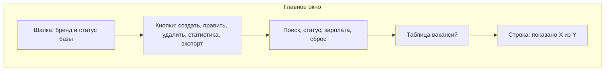
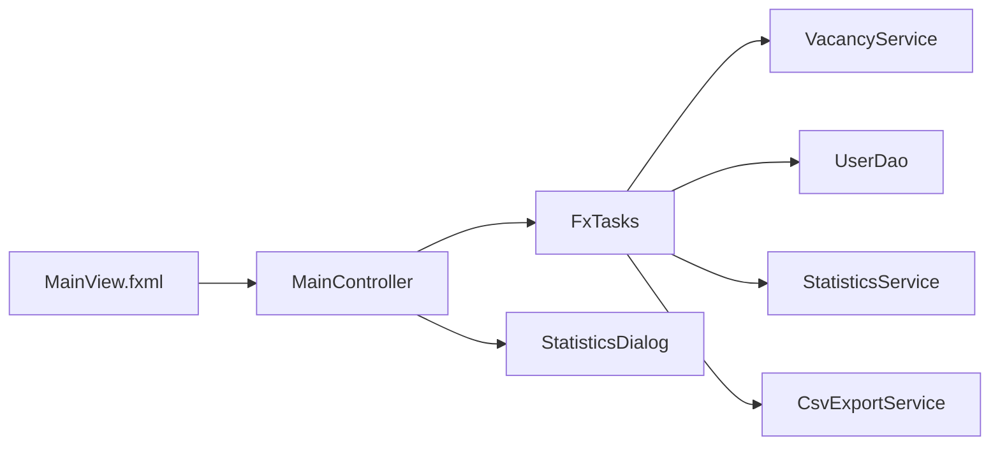
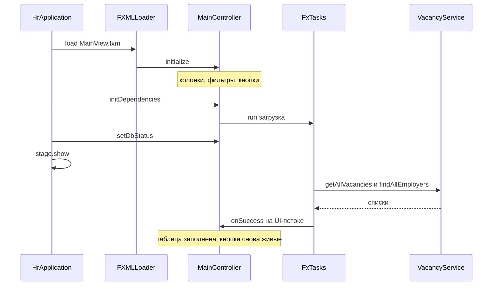
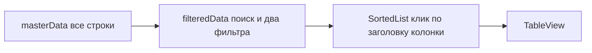
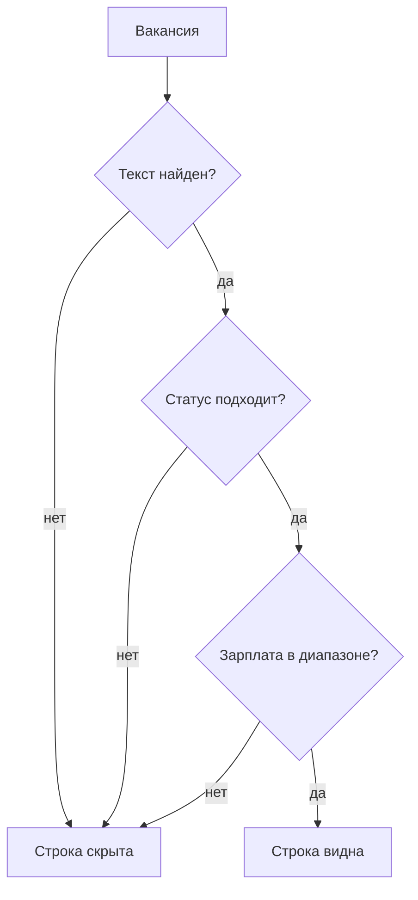
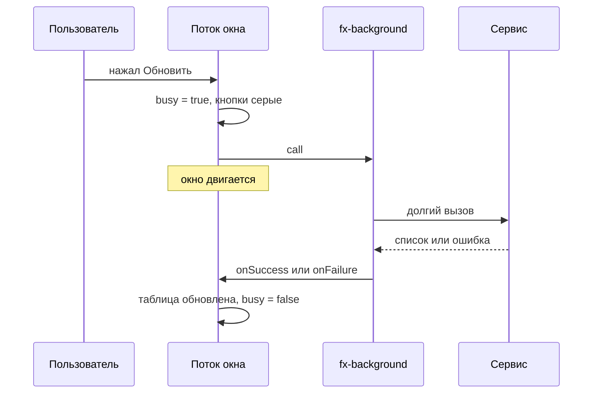
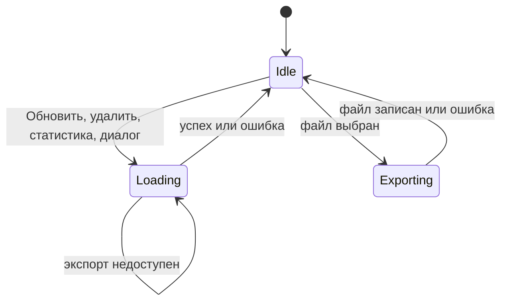
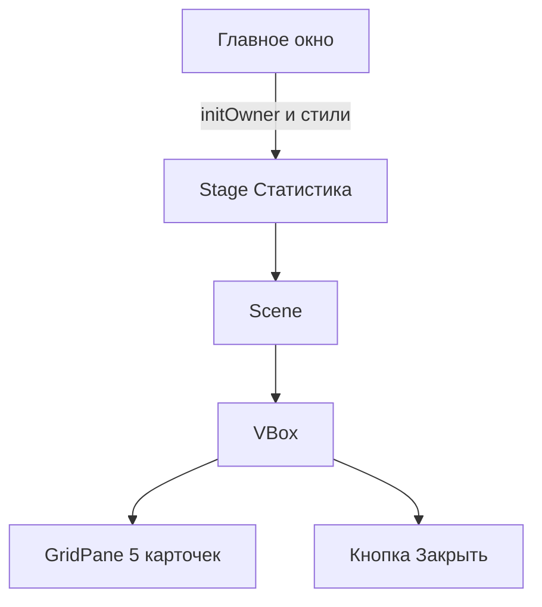
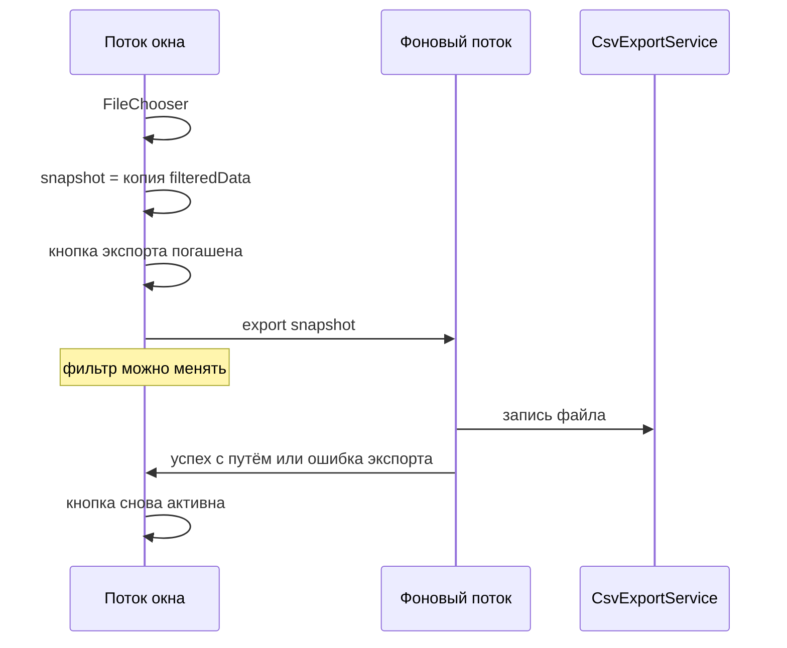

# Интерфейс вакансий

Это описание окна, которое собрал Глеб. Оно показывает список вакансий, фильтрует его на экране и не замирает, пока данные читаются или пишутся.

Рядом лежат два соседних текста:

- [куда это подключать](gleb-integration.md) — для Дамира, Максима и Эдика;
- [обучалка по Java](gleb-java-tutorial.md) — если код хочется разобрать с нуля.

Запуск без Docker: из папки `javafx-client` команда `mvn javafx:run`. База сейчас не открывается, шапка пишет «Автономный режим (Stub)», в таблице 8 учебных вакансий.

## Из чего состоит окно

Разметка уже лежит в `javafx-client/src/main/resources/ru/mirea/hrsystem/view/MainView.fxml`. Java-код только наполняет её данными и реагирует на кнопки. Цвета и карточки статистики — в `css/app.css`.

| Файл | Зачем |
|---|---|
| `ui/MainController.java` | Таблица, фильтры, кнопки |
| `ui/util/FxTasks.java` | Уводит долгую работу с экрана |
| `ui/StatisticsDialog.java` | Пять карточек метрик |
| `ui/util/UiUtils.java` | Окна ошибок, успеха и подтверждения |
| `HrApplication.java` | Создаёт сервисы и отдаёт их контроллеру |

Контроллер не пишет SQL и не считает среднюю зарплату. Он просит сервис и рисует ответ.

## Как окно появляется

`FXMLLoader` сначала создаёт контроллер и вызывает `initialize()`. В этот момент сервисов ещё нет: можно настроить колонки и фильтры, нельзя ходить в базу.

Потом `HrApplication` вызывает `initDependencies(...)` и `setDbStatus(...)`. Только здесь стартует загрузка.

Шапка зависит от флага, который пришёл снаружи:

- `true` — «PostgreSQL подключен»;
- `false` — «Автономный режим (Stub)».

Сейчас `DatabaseManager.testConnection()` всегда возвращает `false`, поэтому второе сообщение. Когда Эдик научит метод реально проверять базу, текст сменится сам.

## Три списка, одна таблица

В памяти живут все загруженные вакансии. На экране виден не этот список, а два вида поверх него.

Поиск не ходит в базу. Человек печатает «Spring», предикат пересчитывается, таблица сразу показывает подходящие строки. Счётчик внизу: «Показано: X из Y вакансий». X — сколько прошло фильтр, Y — сколько пришло с сервера.

Клик по заголовку колонки сортирует уже отфильтрованные строки. Исходный порядок в `masterData` при этом не ломается.

## Фильтры

Вакансия остаётся на экране, только если прошла все три проверки сразу.

Поиск без учёта регистра смотрит в название, компанию и описание. Пустое описание не роняет программу: перед `contains` есть проверка на `null`. Пустая строка поиска пропускает все вакансии.

Статусы в списке: «Все статусы», `ACTIVE`, `ARCHIVED`, `REJECTED`.

Зарплата сравнивается по полю «от» (`salaryMin`), не по верхней границе. Деньги — это `BigDecimal`, сравнение через `compareTo`, не через `==`.

| Пункт списка | Условие |
|---|---|
| Вся зарплата | любая, в том числе пустая |
| до 100 000 | `salaryMin` не пустая и `<= 100000` |
| 100 000–200 000 | от 100000 до 200000 включительно |
| от 200 000 | `salaryMin >= 200000` |

Если «от» не заполнено, узкий диапазон такую вакансию прячет.

На восьми учебных строках это выглядит так:

| Вакансия | От | Статус | до 100 тыс. | 100–200 | от 200 | слово Spring |
|---|---:|---|---|---|---|---|
| Java Backend Developer | 160000 | ACTIVE | | да | | да, в описании |
| Senior Java / Kotlin | 320000 | ACTIVE | | | да | |
| Junior Java QA | 80000 | ACTIVE | да | | | |
| Team Lead Java | 350000 | ARCHIVED | | | да | |
| Java Desktop Developer | 140000 | ACTIVE | | да | | |
| Middle Spring Boot | 190000 | ACTIVE | | да | | да, в названии |
| Стажер Java | 45000 | ACTIVE | да | | | |
| Legacy Java 8 | 120000 | REJECTED | | да | | |

«Сброс» очищает поле поиска и возвращает оба списка на первый пункт. Предикат пересчитается сам, отдельную кнопку «применить» нажимать не нужно.

Строка со статусом `ARCHIVED` рисуется полупрозрачной. Это псевдокласс `archived` на строке таблицы и правило `.table-row-cell:archived` в CSS. Цвет не зашит в Java через `setStyle`.

## Почему окно можно двигать во время загрузки

Чтение списка, удаление, расчёт статистики и запись CSV идут не в потоке окна. `FxTasks.run` создаёт `Task`, запускает его в daemon-потоке `fx-background` и возвращает результат обратно на поток JavaFX.

В `onSuccess` можно менять таблицу. В `call()` — нельзя: JavaFX выбросит ошибку, если трогать кнопки из чужого потока.

Пока `busy` равен `true`, неактивны таблица, «Обновить», «Новая вакансия», «Редактировать», «Удалить» и «Экспорт». «Редактировать» и «Удалить» ещё и ждут выбранную строку. Двойной щелчок по строке открывает правку, но только когда окно не занято.

Экспорт устроен чуть иначе. На время записи гаснет только кнопка экспорта. Поиск можно менять: в файл уже ушёл снимок, живой список ему не нужен.

## Что делает каждая кнопка

### Обновить

Снова читает вакансии и работодателей. Старые строки заменяются целиком через `masterData.setAll`.

### Новая вакансия и Редактировать

Сначала в фоне запрашивается список работодателей. Потом на потоке окна вызывается `VacancyDialog.show(owner, vacancy, employers)`. Для новой вакансии `vacancy` равен `null`. Для правки туда уходит выбранная строка.

Диалог пока бросает «Метод не реализован»: это задача Дамира. Контроллер ловит исключение и показывает «Диалог вакансии», таблица остаётся на месте. Когда диалог начнёт закрываться сам, контроллер перечитает список.

### Удалить

Спрашивает подтверждение. «Нет» ничего не делает. «Да» вызывает `vacancyService.deleteVacancy(id)` в фоне и заново грузит таблицу. На стабе удаление уже работает.

### Статистика

В фоне вызывается `statisticsService.calculateMetrics()`. Если метод вернул `StatisticsDto`, открывается модальное окно. Если бросил исключение, видно «Ошибка статистики», карточки с нулями не показываются.

Сейчас расчёт ещё не написан, поэтому кнопка честно показывает ошибку.

Окно статистики — отдельный `Stage` поверх главного. Пока оно открыто, главное окно не кликается (`APPLICATION_MODAL`). Пять карточек:

| Карточка | Поле `StatisticsDto` |
|---|---|
| Всего вакансий | `totalVacancies` |
| Активных вакансий | `activeVacancies` |
| В архиве | `archivedVacancies` |
| Средняя зарплата от | `averageSalaryMin`, формат `175 625 ₽` |
| Максимальная зарплата | `maxSalary` |

Стили карточек: `metric-card`, `metric-value`, `metric-title`. Окно забирает ту же таблицу стилей, что и главное, поэтому карточки выглядят так же, как задумано в `app.css`. Кнопка «Закрыть» прячет окно.

Числа считает Дамир. Глеб только раскладывает готовый объект по подписям.

### Экспорт в CSV

На потоке окна открывается выбор файла. Если человек нажал «Отмена», ничего не пишется. Если файл выбран, текущий отфильтрованный список копируется в новый `ArrayList`. Эта копия уходит в `csvExportService.export(snapshot, file)`.

Копия нужна, потому что человек может менять поиск, пока файл пишется. Если отдать в экспорт живой список, итерация и изменение списка столкнутся.

Запись файла — задача Дамира. Пока метод бросает исключение, появляется «Ошибка экспорта», кнопка снова включается.

## Ошибки

Любой сбой фона попадает в `showError`: строка в лог SLF4J и окно `UiUtils.showErrorAlert`. Пустой `catch` нет. Сообщение берётся из исключения; если текста нет, показывается сам объект ошибки.

Окно при этом не закрывается.

## Чего в этом слое нет

- SQL и чтение `database.properties` — Эдик и Максим;
- подсчёт пяти метрик и запись CSV — Дамир;
- форма создания вакансии — Дамир, `VacancyDialog`;
- графики, фильтр по дате, выгрузка в Excel.

Проверки фильтра без окна лежат в `VacancyFilterTest`: «до 100 000» оставляет 80 000 и 45 000, «от 200 000» оставляет 320 000 и 350 000, «Spring» находит две вакансии, пустые фильтры оставляют все 8.
